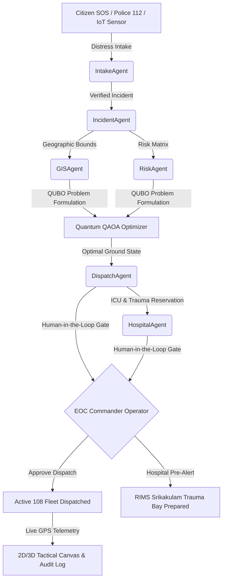

# AERT 3.0 — AI Emergency Response & Spatial Digital Twin Operating System

[](https://github.com/vikasvikky9870/AERT/actions/workflows/deploy.yml)
[](https://vikasvikky9870.github.io/AERT/)
[](https://vikasvikky9870.github.io/AERT/)
[](LICENSE)

> **Primary Operational District**: Srikakulam District, Andhra Pradesh, India (`AP-SKLM-EOC-01`)  
> **Command Center Coordinates**: `[83.8961°E, 18.2969°N]` (7 Road Junction EOC)  
> **Production Live URL**: **[https://vikasvikky9870.github.io/AERT/](https://vikasvikky9870.github.io/AERT/)**  
> **GitHub Repository**: **[https://github.com/vikasvikky9870/AERT](https://github.com/vikasvikky9870/AERT)**

---

## 🌐 Executive Overview

**AERT 3.0** is an enterprise-grade Emergency Response & Digital Twin Command Platform designed specifically for Srikakulam District. It combines **9 domain-isolated autonomous AI agents**, **Quantum QAOA combinatorial optimization** for congestion-free arterial corridor routing, and a **2D/3D WebGL Digital Twin** to dramatically compress the **Golden Hour** response window for critical casualties.

### Key Capabilities

1. **Multi-Agent Orchestration**: 9 specialized agents (Intake, Incident, GIS, Dispatch, Hospital, Risk, Simulation, Command, Reporting) running with strict security boundaries and deterministic validation.
2. **Quantum QAOA Routing**: Formulates emergency routing as a Quadratic Unconstrained Binary Optimization (QUBO) problem solved with simulated QAOA unitaries to avoid urban bottlenecks during severe weather and arterial closures.
3. **Deterministic Verification Gate**: Hard geodesic distance checks, fleet capability matching (ALS vs BLS), and real-time hospital ICU bed reservation.
4. **Tactical Spatial Canvas**: High-fidelity MapLibre GL 2D tactical maps, 3D WebGL emergency mesh views, dynamic traffic heatmaps, and live moving vehicle telemetry.
5. **Human-in-the-Loop EOC**: Command-level authorization gates ensuring operator sign-off before fleet dispatch, backed by an immutable audit trail.
6. **Resilient Citizen SOS**: Mobile distress intake supporting automated sensor triggers, live GPS pin location, and resilient mesh/LoRa offline dispatch fallback.

---

## 🗺️ Real-World Srikakulam Operational Scenarios

AERT 3.0 features 4 fully validated, street-accurate operational scenarios adhering to Srikakulam's actual road network:

1. **NH-16 Express Multi-Vehicle Pileup**: High-speed trauma dispatch on NH-16 bypass with Level-1 Trauma Bay handover at RIMS Medical College.
2. **Nagavali River Monsoon Flash Flood**: Causeway submersion detour directing emergency fleet around flooded low-water causeways via high-level bridge routes.
3. **Coastal Cyclonic Distress & STEMI Cardiac Shock**: Green corridor traffic light preemption along Beach Road for urgent cath-lab intervention.
4. **Singupuram SEZ Toxic Chemical Release**: 1,200m HAZMAT safety cordon calculation with automated downwind corridor evacuation routing.

---

## 🏗️ System Architecture



---

## 🚀 Quick Start & Local Execution

### Prerequisites
- Node.js 18+ & npm
- Python 3.11+
- Git

### 1. Automated One-Click Launch (Windows)
```cmd
start_aert_platform.bat
```

### 2. Manual Development Setup

#### Backend (FastAPI + Multi-Agent Intelligence)
```bash
cd backend
python -m venv venv
venv\Scripts\activate       # On Linux/macOS: source venv/bin/activate
pip install -r requirements.txt
uvicorn main:app --reload --port 8000
```
Backend runs at `http://localhost:8000`. API docs available at `http://localhost:8000/docs`.

#### Frontend (React + Vite + MapLibre GL)
```bash
cd frontend
npm install
npm run dev
```
Frontend runs at `http://localhost:5173`.

---

## 🐳 Docker Container Deployment

Deploy the entire stack with a single Docker Compose command:

```bash
docker-compose up --build -d
```

- **Frontend**: `http://localhost:5173`
- **Backend API**: `http://localhost:8000`

---

## 🧪 Testing & Verification

All test suites run deterministically without external API dependencies:

### Backend Test Suite (25 Tests)
```bash
cd backend
python -m unittest test_aert_platform.py test_agents_suite.py test_api_suite.py test_quantum_suite.py
```

### Frontend Build & Lint Verification
```bash
cd frontend
npm run lint    # Oxlint high-speed linter (0 errors)
npm run build   # Production bundle build
```

---

## 📦 Deployment

### Production GitHub Pages
- Pushes to the `main` branch automatically trigger `.github/workflows/deploy.yml` which executes all test suites, builds the production client, and publishes the live site to:
  **`https://vikasvikky9870.github.io/AERT/`**

---

## 📜 Sector Compliance & Standards
- **District**: Srikakulam, AP, India (`AP-SKLM-EOC-01`)
- **Bounding Box**: `[83.7000, 18.1500]` to `[84.1500, 18.5000]`
- **Audio Synthesis**: Native Web Audio API oscillators (`soundManager.js`) with zero external sound asset dependencies.
