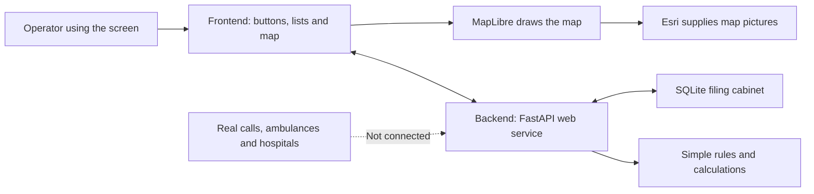
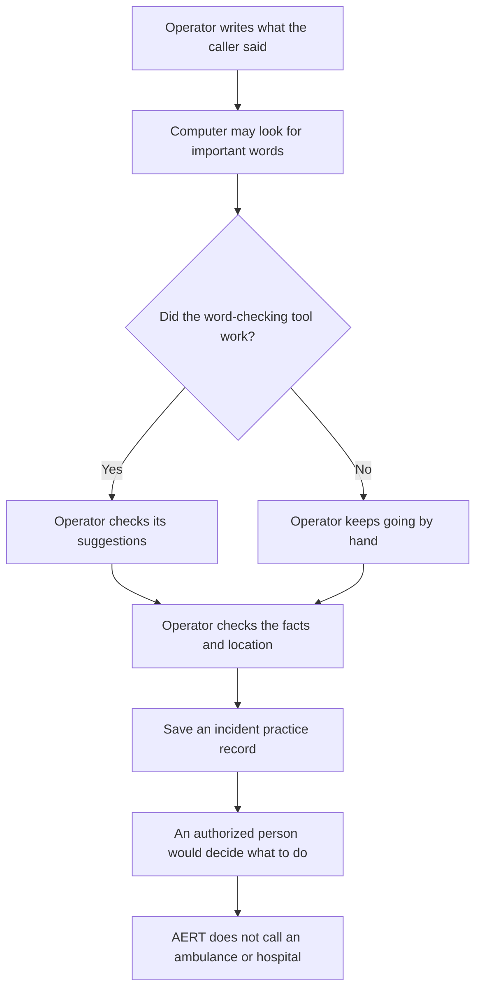

# AERT explained in simple words

## First: what is AERT?

Imagine a busy school office during a fire drill. One person answers messages, another checks a map, and someone else checks which helpers are free. They need one place to see what is happening and decide what to do.

**AERT is a computer practice model for that kind of emergency office.** It is meant to help people look at incidents, maps, vehicles, hospitals, and road problems together.

It is **not connected to real emergency calls or real ambulances**. Some screens look like a real control room, but much of the information is made up for practice. Think of it like a flight simulator: it can show what might happen, but it does not fly a real airplane.

## A very important thing to know

When someone opens the app normally, they see the **main map screen**. It has pretend traffic, pretend vehicle movement, and sample hospital and ambulance information. Some labels make these things look live, even though they are examples.

The newer, safer call-intake screen is in another part of the app. It opens with `?legacy` added to the web address. That screen is also a practice tool, but it is clearer about what is real and what is only a suggestion.

So: **this app is for learning and demonstration, not for handling a real emergency.**

## How the pieces fit together

Think of AERT like a school office with a map on the wall:

- The **frontend** is the room you can see: buttons, maps, lists, and messages.
- The **backend** is the helper behind the desk: it checks requests and does calculations.
- The **database** is the filing cabinet: it remembers records.
- The **map service** supplies the picture of roads and places.
- The **real emergency services** would be outside partners. AERT is not connected to them today.

## What happens when someone reports an emergency?

Here is the safer version of the process the app is trying to show:

The computer’s word-checking is like a helper highlighting words in a letter. It might miss something or misunderstand it, so a person must check it. If the number of people is unknown, the app should leave it unknown instead of guessing.

## What technologies are used?

“Technology” just means the tools the makers used to build the app.

| Tool | Simple explanation | Why it is here |
|---|---|---|
| **React** | Helps build a screen from small pieces, like blocks in a toy set. | Makes maps, buttons, cards, and panels work together. |
| **Vite** | A fast workbench for building the website. | Helps developers run and package the frontend. |
| **MapLibre** | A tool for showing and moving around an interactive map. | Draws the map and lets the user zoom or select markers. |
| **Esri map tiles** | Small picture pieces that join together to make a map. | Provides the background map. It does not check whether AERT’s own pins are correct. |
| **Three.js** | A tool for drawing 3D pictures. | Makes a practice 3D view. It is not a measured map of real buildings. |
| **FastAPI** | A way for the screen to ask the backend for information. | Provides web addresses that send and receive data. |
| **Pydantic** | A form checker for data. | Checks that a request has the expected fields and types. It cannot prove that the information is true. |
| **SQLite** | A small database stored as a file. | Saves practice incidents and other records on this computer. |
| **Python and NumPy** | Tools for writing rules and doing maths. | Used for scoring and a computer simulation of an optimization idea. |
| **scikit-learn** | A toolbox for machine-learning experiments. | Installed in the project, but a real, tested traffic-learning system has not been shown. |
| **Lucide icons and CSS** | Pictures and colors used in the screen. | Help people recognize buttons and understand the layout. |

### What does “AI” mean here?

The word “AI” is used for several different things in this project. Here is the simple version:

1. **Word finder:** looks for certain words in notes. It does not listen to a phone call.
2. **Rule checker:** adds up points or follows instructions written by a programmer. It is not a doctor.
3. **Agent code:** is organized into parts named like helpers or agents. That does not mean those parts are smart humans or verified AI models.
4. **Quantum-style experiment:** tries an optimization method using ordinary computer maths. It does not use a real quantum computer.
5. **Machine-learning toolbox:** exists in the project, but there is no proof here that it learned from accurate local emergency data.

**There is no working photo-identification tool, live speech-to-text, or connected ChatGPT-like assistant in the app.**

## What can the app show or do?

| Feature | What it does in the practice app | Is it real? |
|---|---|---|
| Map | Shows a map and sample incident, vehicle, hospital, or hazard markers. | The background map is supplied by Esri. Many special markers and routes are examples. |
| Incident list | Shows and saves emergency-shaped records. | Records can be stored, but they may be practice data. |
| Call intake | Lets an operator write notes and see possible word matches in the newer screen. | No real phone call or audio is connected. |
| Ambulance panel | Shows vehicle records and status labels. | No ambulance GPS is connected. The moving vehicle in the main screen is an animation. |
| Hospital panel | Shows hospital-shaped records and capacity numbers. | No hospital bed system is connected; the numbers are examples. |
| Road problems | Shows traffic lines, closures, or flood-like scenarios. | No live traffic, flood sensor, or road authority feed is connected. |
| 3D view | Shows a computer-made 3D scene. | It is not accurate enough to guide a driver. |
| Practice mission | Plays a scripted emergency story from call to report. | It is a demonstration, not a real emergency. |
| Reports and audit | Shows saved activity and summary information. | It needs more checking before anyone uses it for official reporting. |

## How does the computer talk to itself?

The screen sends a message to the backend using a web request. The backend may check it, save it in SQLite, and send a reply. This is similar to filling out a form at the office counter and having the clerk put it in a filing cabinet.

For example:

1. The screen asks, “Please show the incidents.”
2. The backend reads them from the database.
3. The backend sends them back as JSON. JSON is a tidy way computers package information.
4. The screen puts the information into a list or on the map.

The project uses normal web requests, not a live radio connection or a constant streaming link. The screen may show saved records while no real emergency system is connected.

## What is already in the project, and what is still missing?

### Already present

- A map-first screen with map controls and filters.
- Example incident, ambulance, hospital, and road-event records.
- A local database and web API.
- A 10-step incident-status list, such as reported, dispatched, on scene, and resolved.
- A newer call-note screen with a simple word checker and manual review.
- A practice 3D scene, rule-based scoring, and a computer optimization experiment.
- Audit and reporting code.

### Not connected yet

- Real 112/108 calls, phone audio, caller location, text messages, or radio.
- Real ambulance location and availability.
- Verified district roads, road closures, and traffic speeds.
- Real hospital bed availability or hospital acceptance of a patient.
- Uploading or identifying emergency photos.
- A tested medical decision system.
- A real quantum computer.
- User accounts, permissions, secure deployment, and a production database setup.

## What should be fixed first?

Think about the worst possible surprise: a person believes the screen has called an ambulance, but it only moved a picture. To prevent that kind of mistake:

1. Make the clear, honest screen the normal screen people see.
2. Change words like “live,” “sent,” and “available” unless a real system confirms them.
3. Put a “practice example” label beside every made-up number, route, pin, and hospital value.
4. Show when data was last updated and where it came from.
5. If a service stops working, show “unknown” or “not connected.” Never fill in a believable guess.
6. Make a person check the caller’s location, patient count, hazards, and any computer suggestions.
7. Only call something “sent” after the other system says it received the message.

## What would a real version need later?

This is a possible order for future work:

1. **Make the practice version honest:** clearly mark all pretend data and fix the default screen.
2. **Use trusted maps and records:** get approved roads, boundaries, hospitals, and service data.
3. **Protect people’s information:** add sign-in, job roles, privacy rules, and secure storage.
4. **Connect real services carefully:** work with the authorized emergency and hospital systems, first in a safe test environment.
5. **Check every message:** show whether a dispatch or hospital alert was accepted, failed, or is still waiting.
6. **Test any AI:** use many reviewed examples, including confusing calls, different languages, bad audio, and wrong information.
7. **Practice failures:** test no internet, old GPS, duplicate calls, unknown locations, busy hospitals, and power loss.
8. **Ask experts to approve it:** emergency operators, medical professionals, map experts, security staff, and local authorities.

## A few big words, made small

- **Frontend:** the part you can see and touch.
- **Backend:** the part that works behind the screen.
- **Database:** a digital filing cabinet.
- **API:** a doorway that lets two programs pass messages.
- **GIS:** computer maps and location information.
- **GPS/AVL:** information about where a vehicle is and when that location was measured.
- **ETA:** an estimate of when someone might arrive. It needs good maps and current traffic to be useful.
- **Fixture or seed data:** pretend/example information added so the app has something to show.
- **Human review:** a real person checks the computer’s suggestion before acting.
- **QAOA/QUBO:** names for maths methods that try to choose a good answer from many possible choices. This project simulates one on a normal computer.

## The whole idea in one sentence

**AERT is a practice control-room app that shows how maps, incident notes, vehicles, hospitals, and response decisions could fit together—but it must be connected to trusted real systems and carefully tested before it can help with real emergencies.**

### Useful links

- [India’s 112 Emergency Response Support System](https://112.gov.in/about)
- [National Health Mission information about 108 ambulance services](https://nhm.gov.in/nhm_live/index1.php?lang=1&level=2&lid=189&sublinkid=1217)
- [Official Srikakulam district map page](https://srikakulam.ap.gov.in/map-of-district/)
- [Esri map service information](https://developers.arcgis.com/rest/basemap-styles/arcgis-darkgray-style-get/)

---

This beginner guide describes the code in this repository as reviewed on 11 October 2026. It does not mean the system is approved or ready for real emergency work.
