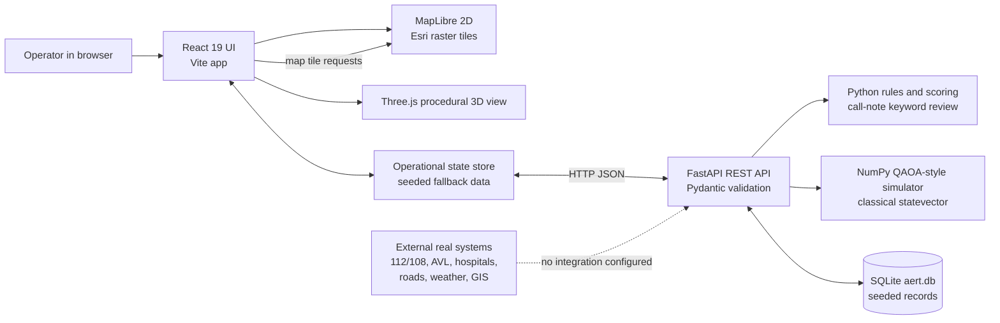
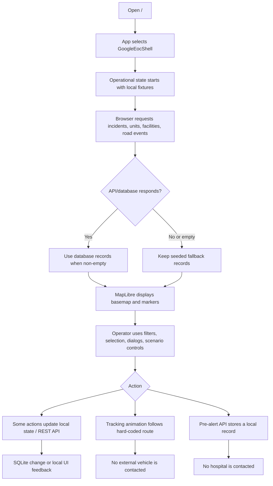
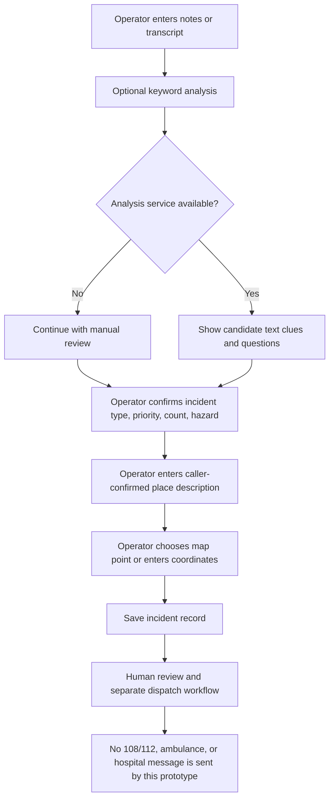
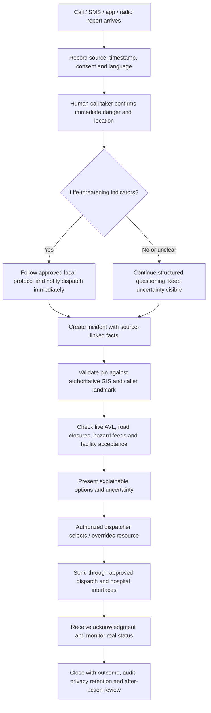

# AERT Application: Technology, Features, Architecture, and Roadmap

**Application:** AERT — AI Emergency Response & Traffic Intelligence Platform  
**Area represented:** Srikakulam, Andhra Pradesh, India  
**Repository build:** React/Vite frontend with a FastAPI backend and a local SQLite database  
**Current operating mode:** Training/demo data; not connected to a real emergency dispatch network

> **Read this first — important accuracy note.** The default page is `GoogleEocShell`, selected in `frontend/src/App.jsx`. Despite its name and operational appearance, it uses MapLibre with Esri raster tiles, seeded database records, and hard-coded route, traffic, weather, crew, and tracking examples. Its “live” ambulance movement is a browser animation. Its “pre-alert” writes a local database record; it does not contact a hospital. The safer call-intake and AI-review redesign lives in `OperationalShell`, which is only selected by `?legacy` or `#legacy`. Therefore the safe intake redesign is **not yet the default user experience**, and the default screen still contains claims that must be corrected before this can be shown as a live-response system.

## 1. What the application is

AERT is a geographic emergency-operations prototype. It brings together a map, incident records, ambulance and hospital fixture records, road events, scenario controls, and response workflow screens. Its goal is to demonstrate how an emergency coordination center might review a call, establish an incident, understand resources and hazards, choose a response, communicate with a receiving facility, and learn from the outcome.

The repository contains two generations of UI:

| Entry point | How to open | Purpose and current state |
|---|---|---|
| Default Google-style EOC | `/` | Main map-first demo. It contains useful map controls and seeded records, alongside simulated telemetry and unverified scenario overlays. “Google” describes the visual inspiration; no Google Maps SDK is installed. |
| Operational shell | `/?legacy` or `/#legacy` | More modular command workspace. Includes the newer call-intake and evidence-review screens, explicit training labels, and safer operator review. It is not currently the default. |
| Map Lab | `/map-lab`, `/#map-lab`, or a query containing `map-lab` | Separate map/synthetic-data exploration workspace. |

There is no full client-side router in the inspected entry point. `App.jsx` branches on the browser path, query, and hash.

## 2. Technology stack and why it is used

| Layer | Technology in this repository | Role and reason |
|---|---|---|
| Browser application | React 19 | Composes the map, incident panels, dialogs, and workspace UI as reusable components. |
| Frontend build/dev server | Vite 8 and `@vitejs/plugin-react` | Local development with fast reload and optimized production builds. |
| Styling | CSS, CSS variables, custom component styles | Controls the map-first EOC visual system, responsive layout, status colors, and interaction states. The repo has more than one design generation. |
| Icons | `lucide-react` | Consistent scalable interface icons. |
| Interactive 2D map | MapLibre GL JS 6 | Renders map styles, raster tiles, GeoJSON routes/overlays, markers, and map interactions. |
| Map imagery | Esri-hosted raster tile services | Street, imagery, and dark basemaps. These tiles do **not** verify AERT's custom points, routes, traffic values, or emergency facilities. External tile access and provider terms/attribution apply. |
| 3D visualization | Three.js 0.185 | Renders the optional procedural digital-twin view. It is a visualization, not a surveyed, scale-accurate navigation model. |
| API server | Python 3 + FastAPI 0.141 | Provides JSON HTTP endpoints for incidents, resources, road events, analysis, simulation, and audit data. |
| Request validation | Pydantic 2 | Validates API payload shapes and basic field constraints. Validation does not prove that a caller statement or coordinate is true. |
| Persistence | SQLite (`backend/aert.db`) through Python `sqlite3` | Lightweight local persistence for the prototype. It is not a managed, replicated, multi-user production database. |
| Rules/numerical intelligence | Python modules, NumPy 2.5; scikit-learn 1.9 is installed | Implements deterministic scoring/rules and a QAOA-style statevector simulator. The repository does not show a connected quantum device or validated, live-trained district traffic model. |
| Tests / linting | Python unittest files; Playwright and Oxlint dependencies; `npm run lint` | Test and lint scaffolding exists. This overview does not assert all tests pass or that browser end-to-end coverage is complete. |

### Map naming and source clarification

`frontend/src/google-eoc/googleMapStyles.js` calls its styles “Google,” but their raster URLs point to Esri ArcGIS services. The rendering library is MapLibre. No Google Maps JavaScript API dependency or Google Maps API key is configured in `frontend/package.json` or the inspected map styles. The distinction matters for data provenance, licensing, and an honest description of the map.

### AI and optimization naming clarification

“AI” in this repo is a collection of different methods, not one connected general-purpose AI model:

1. `backend/call_intake.py` uses deterministic keyword patterns to surface candidate labels, selected safety phrases, and questions. It does not transcribe speech, understand Telugu, geocode, diagnose, or dispatch.
2. `backend/intelligence.py` contains deterministic scoring, distance/time approximations, resource-conflict checks, and prompt-to-response rules. These are software rules, not a hosted LLM.
3. `backend/agents.py` contains agent-shaped Python classes and an orchestrator. Some extraction logic is fixed to a few terms/coordinates; “agent” does not mean an autonomous model with verified evidence.
4. `backend/quantum_optimization.py` formulates QUBO-like selection and simulates a QAOA-style statevector numerically with NumPy. It is a classical simulation, not quantum hardware. The default UI also has hard-coded route scores and telemetry, so those display values must not be presented as measured model results.
5. A HistGradientBoostingRegressor class and scikit-learn dependency are present, but a production data pipeline, training dataset provenance, validation report, drift monitoring, and calibrated ETA service were not established by this inspection.

## 3. Main features and status

“Exists in code” is not the same as “operationally connected.”

| Feature | What exists | Status / limitation |
|---|---|---|
| Map and entity markers | MapLibre map, basemap choices, filters, incident/ambulance/hospital pins, map selection and zoom | Basemap is externally hosted; many overlays and coordinates are sample or hard-coded. An accurate tile background does not make each marker accurate. |
| Incident records | Create/read/update-style API and a 10-stage lifecycle in SQLite | Database initializes with seeded examples. Local persistence is not a dispatch-system integration. |
| Call intake | Default shell has an older scenario-led call dialog; alternate shell has operator-entered notes, keyword review, follow-up questions, and a map pin chooser | No phone/108/112 connection, call recording, automatic speech recognition, caller-ID, GPS, language model, image upload, or image identification. Safer intake is alternate-shell only. |
| Fleet view | Ambulance records, status labels, pins, assignment/lifecycle operations | Seeded values; no AVL/GPS device feed, radio, vehicle system, or verified availability. Default shell animates a marker along fixed waypoints. |
| Hospital network | Facility records, capacity labels, pre-alert records | Seeded facility/capacity data; no hospital system, bed-management feed, acceptance acknowledgment, or actual outbound alert. |
| Traffic and hazards | Hard-coded road lines, delays, hazard events; API can store road-event records and scenario disruptions | No connected traffic authority, road closure feed, flood sensor, weather service, or validated road graph. Default visualization can look live despite being a scenario. |
| AI decision support | Rule/scoring endpoints, resource-conflict calculations, incident pipeline, a copilot-style endpoint | Not a clinically validated triage system, calibrated confidence service, or generative AI integration. Alternate AI review page is deliberately candid; default shell still includes simulated QAOA claims. |
| Scenario / “Golden Slice” | 18-step animated emergency demonstration | Demonstration events and facts are scripted. The flow can write simulated lifecycle, road, and pre-alert records to the local database. It does not represent a real call or real response. |
| Audit and analytics | Audit/event tables and summary endpoints; UI displays event/activity and reporting views | Data quality, retention, access controls, and production reporting definitions remain to be designed. |
| Sound and visual alerts | Browser-generated UI tones and animation | Interface feedback only; not an emergency alarm channel or notification service. |

## 4. System block diagram

**How to read it:** the solid lines are the present software shape; the dotted external-system relationship is a missing integration. The map tiles come from Esri endpoints, while AERT's emergency-specific overlays and data have separate provenance and are not automatically verified by the tile provider.

## 5. Workflow flowcharts

### Current default application flow

### Safer call-to-incident workflow in the alternate shell

This is an operator-assisted record workflow, not a replacement for an approved emergency call-taking protocol. An approximate count should remain approximate/unknown; the rules are not reliable enough to infer urgency or safety from missing words.

### Recommended real-world emergency workflow (future target)

## 6. Methods used and solution choices

### Methods currently in the repository

- **State management:** a custom operational store publishes state changes to React components. It initializes from in-memory fixtures and attempts REST sync. This keeps UI screens coordinated but is not a multi-user event stream; no WebSocket or Socket.IO connection was found.
- **Mapping:** MapLibre displays raster tile services and overlays built from coordinates, GeoJSON, or DOM markers. It provides pan/zoom and selection. The default route lines are coordinates authored in code, not routes calculated from a current street graph.
- **Distance/time approximations:** the backend includes Haversine great-circle distance and simple speed/delay calculations. Straight-line distance is not road-network distance; realistic ETA needs a routable graph and current traffic data.
- **Incident classification:** deterministic keyword matching in the newer intake endpoint. This is easy to inspect and works offline, but has poor recall/precision across negation, speech recognition errors, multilingual speech, context, and medical phrasing.
- **Decision scoring:** explainable rule/multi-criteria calculations in Python. A factor breakdown is easier to audit than an opaque score, but its weights and input data need expert validation and calibration before use.
- **Optimization experiment:** QUBO encoding plus QAOA-like numerical simulation, compared with classical choices. Useful as a research/demo method; no evidence in this repository establishes that it beats a classical production optimizer on realistic district-scale data.
- **Persistence:** local SQLite is low-friction for a single-machine proof of concept. Real emergency centers need a secure, backed-up, concurrent database, migrations, availability targets, and audited access.
- **Human-in-the-loop:** the redesigned alternate shell separates note clues from operator decisions and separates record creation from dispatch. The default shell has older buttons that can imply real dispatch or hospital communication; this inconsistency is a high-priority remediation.

### Existing technology versus the proposed/implemented solution

| Need | Current prototype method | Suitable production direction |
|---|---|---|
| Know what caller says | Manual notes; some scripted demo transcription; optional keyword rules | Approved telephony integration, recorded source metadata, tested speech-to-text, human correction, Telugu/English/mixed-language evaluation, explicit fallback when transcription fails |
| Know where the event is | Operator text and chosen/manual coordinates; fixtures and static coordinates also exist | Caller consented device location where available, authoritative geocoder/administrative boundaries, road/address/landmark search, uncertainty radius, independent call-taker confirmation |
| Identify hazards from images | No image intake or image model in the app | Secure evidence upload, malware/type checks, consent and privacy controls, image metadata handling, model-assisted description with source and uncertainty, mandatory human confirmation; never infer patient severity solely from an image |
| Know where responders are | Seeded unit coordinates and a simulated moving marker | AVL integration with timestamps, stale-feed indication, communications outage behavior, verified unit status and assignment protocol |
| Know route and ETA | Static route alternatives and simple distance/delay examples | Licensed/authoritative routable graph, validated restrictions for emergency vehicles, live closures/traffic, offline fallback, uncertainty ranges, dispatcher confirmation |
| Know facility readiness | Seeded capacity values and local pre-alert rows | Hospital information-system agreement, live bed/trauma capability, explicit acceptance/acknowledgment, secure messaging, stale-data flags |
| Make recommendations | Rule scoring, hardcoded QAOA telemetry, a numerical experiment | Begin with audited deterministic optimization; compare with baseline; measure against real historical data; only deploy calibrated models under clinical/operational governance |
| Operate securely | Local dev server, CORS origins, SQLite | Authenticated roles, least privilege, encryption, secrets management, tamper-evident audit, retention policy, disaster recovery, monitoring, security and privacy review |

The recommended approach is intentionally multi-method: deterministic validation for basic data quality, human questioning for uncertain information, authoritative integrations for facts, optimization for constrained choices, and carefully evaluated models for probabilistic estimates. One model should not be asked to replace the entire emergency workflow.

## 7. Data and API overview

The backend exposes REST/JSON groups for:

- **System:** `/`, `/health`
- **Incidents:** list, detail, create, lifecycle, status, priority queue, analysis and operator override
- **Intake:** `/api/intake/analyze-notes`
- **Resources:** ambulances, hospitals, pre-alert records, road events, resource conflicts
- **Decision support:** intelligence, incident analysis, copilot-style rules, simulation and quantum status
- **Operations:** event disruption, demo scenario activation, SOS trigger, response history, analytics and audit logs

FastAPI endpoints use Pydantic models for selected request types. SQLite tables include incidents, ambulances, hospitals, road events, response history, audit logs, and hospital pre-alert records. Startup runs database initialization and seeds example resources/records. Consequently, values returned by the API can be stored and persistent while still being **synthetic**; persistence does not mean truth.

The frontend API currently points to `http://127.0.0.1:8000`; a second API client supports `VITE_API_BASE_URL`. Backend CORS is configured for local development origins. There is no production environment/configuration manifest in the inspected frontend package and no backend `requirements.txt` was found. The checked-in virtual environment is machine-specific and is not a substitute for a pinned dependency lock/requirements file.

## 8. Visual design and representation

- **Map-first composition:** the main screen gives most space to the map, with entity controls and side panels around it. This matches the geographic nature of emergency coordination.
- **Multiple basemaps:** street, imagery, and dark tiles offer different visual contexts. Imagery can help recognize broad landmarks but cannot confirm a precise address or current scene.
- **Status colors and markers:** icon/color differences help distinguish incidents, vehicles, facilities, and hazards. These must remain accessible without color alone and must show data source/time.
- **Map overlays:** route lines, traffic, boundaries, risk layers, and points are only trustworthy when their source, timestamp, resolution, and uncertainty are visible. Current sample overlays need a prominent “scenario” treatment in the default shell.
- **3D scene:** the Three.js twin can communicate relative positions and scenario flow. It is procedural, not a digital survey, and must never imply measured building or road geometry.
- **Sound and motion:** useful as interface feedback and demonstration cues; they should be restrained, accessible, motion-reduced when requested, and clearly distinguished from official alarms.
- **Typography and panels:** the repository contains multiple CSS systems and component generations, so the visual language is not fully unified. A production redesign should standardize tokens, spacing, type scale, accessibility contrast, responsive behavior, and interaction patterns.

## 9. What has been improved, and what remains

Recent changes in this working tree added a safer intake and AI-review workspace, explicit training/fixture labels in the alternate shell, map coordinate pin selection, hidden unverified infrastructure markers in the tactical map, optional manual intake when keyword analysis fails, a 0/unknown patient-count convention, and no default confidence score for newly created records. Training pre-alert API responses now state that no hospital system was contacted.

These improvements **do not replace or remove the default GoogleEocShell**. The following items remain before the system can be represented accurately even as a polished prototype:

### Immediate corrections

1. Make the safer shell the default or port its honesty labels and call-intake behavior into the default shell.
2. Remove or relabel default “live” language, simulated tracking, invented speed/ETA, fixed crew dossiers, weather/river readings, fabricated bed/capability values, route metrics, “QAOA converged” claims, and successful hospital-delivery messages.
3. Mark each database-seeded incident, facility, unit, coordinate, route, and traffic value as a fixture in both map and details; provide an obvious reset-to-demo control.
4. Make lifecycle transitions and alerts visibly simulated until a real adapter and acknowledged delivery exist. Do not let an internal database write look like external dispatch.
5. Resolve inconsistencies between default shell, alternate shell, legacy components, and seed data so all entry points share one data-honesty and safety model.

### Engineering and validation work

- Add pinned backend dependencies and a clean setup guide; move the API URL to environment configuration consistently.
- Add schema migrations, typed API contracts, deterministic IDs, duplicate prevention/idempotency, and clearer error/timeout behavior.
- Add operator authentication, roles, audit access, privacy controls, retention, backups, encryption, secure deployment, monitoring, and incident response procedures.
- Use authoritative GIS boundaries, geocoding, verified facilities and roads; test coordinates and spatial layers with district domain experts.
- Validate caller-note rules on multilingual real-world-like cases, negation, ambiguity, ranges, conflicting callers, silence, low-quality audio, and non-emergency cases. Keep a manual fallback.
- Add accessible browser end-to-end verification for the primary entry point and all narrow screen widths. A successful production build alone does not prove UI correctness.
- Validate scoring/optimization against a documented baseline and expert-reviewed historical cases. Publish error rates, false-positive/negative behavior, calibration, and limitations.
- Add observability without exposing sensitive caller data; test offline, stale feeds, duplicate incidents, overload, partial database failure, and service restart.

### Future development sequence

1. **Truthful demo:** unify the shells, fixtures, labels, controls, map provenance and realistic failure states.
2. **Verified operational data:** ingest approved GIS/road/facility/resource feeds with source timestamps, uncertainty, outages, and ownership.
3. **Secure operator workflow:** authentication, roles, audit, multi-operator synchronization, call-source capture, accessibility, and training mode separation.
4. **Communications integration:** work with authorized 112/108/dispatch/hospital stakeholders; implement test/sandbox adapters, delivery acknowledgments, retries, and failover before any live use.
5. **AI evaluation:** only after data permissions/governance; test transcription, translation, hazard phrase extraction, optional image descriptions, and decision support against expert-labeled cases. Every model output remains a suggestion with evidence, uncertainty, provenance, and human override.
6. **Operational optimization:** integrate routable roads and real unit status; benchmark classical routing/dispatch first. Consider quantum methods only if a measurable, reproducible advantage exists for the actual constrained problem.
7. **Readiness assurance:** tabletop drills, red-team and failure-mode analysis, independent clinical/dispatch/legal/security review, load tests, disaster recovery, and controlled pilot approval.

## 10. Worst-case scenarios the design must handle

| Failure case | Required behavior |
|---|---|
| Call transcript is wrong or absent | Show “unknown”; allow manual entry; never block emergency notification on AI; retain source and operator corrections. |
| Caller gives only a landmark or approximate location | Keep a visible uncertainty radius and confirmation status; don’t silently snap to a plausible road or invented coordinate. |
| Several callers report the same event | Offer duplicate candidates with evidence; human confirms merge; preserve source call records. |
| Patient count is “at least 5,” “3–5,” or unknown | Store range/qualifier or unknown, not a fabricated exact count. |
| Map tiles or GIS service are unavailable | Keep readable incident text/list and last-update timestamp; distinguish cached from current; provide approved fallback maps. |
| Ambulance GPS is stale or unavailable | Display last fix/time and stale state; don’t animate it as live or route against presumed availability. |
| Facility capacity is unknown or outdated | Display unknown/stale; require direct confirmation/acceptance; do not fabricate a bed count. |
| A dispatch/pre-alert request times out | Show pending/failed/unknown delivery; use idempotent retry and acknowledgment; never say “sent” without confirmation. |
| Backend/database is unavailable | Preserve a controlled manual fallback, local queue where approved, visible unsaved state, and reconciliation after recovery. |
| AI suggests the wrong urgency or resource | Keep operator authority, evidence and reason visible; allow override; capture audit data without blocking urgent protocol actions. |
| Malicious or sensitive image/audio is submitted | Validate file types/size, malware scan, access control, encryption, retention, consent and audit before storing or processing. |

## 11. Glossary

- **AVL:** Automatic Vehicle Location; a timestamped source of vehicle position/status.
- **GIS:** Geographic Information System; authoritative boundaries, addresses, roads, facilities, and spatial reference data.
- **ETA:** Estimated time of arrival. A trustworthy ETA requires an appropriate route graph, current conditions, and calibration.
- **QUBO:** Quadratic Unconstrained Binary Optimization, a way to express a constrained binary selection problem as an objective function.
- **QAOA:** Quantum Approximate Optimization Algorithm. In this app the QAOA-like process runs as a classical NumPy statevector simulation.
- **Human-in-the-loop:** an authorized operator reviews source facts and remains responsible for consequential decisions.
- **Seeded fixture:** synthetic record loaded for demonstration/testing; it may persist in the database but is not a current real-world condition.

## 12. Key source files

- Frontend entry and shell selection: `frontend/src/App.jsx`
- Default map-first interface: `frontend/src/google-eoc/GoogleEocShell.jsx`
- Alternate operations shell: `frontend/src/app/OperationalShell.jsx`
- Shared operational state and fixture fallback: `frontend/src/state/operationalState.js`
- HTTP API client: `frontend/src/api.js`
- Map styles and tile sources: `frontend/src/google-eoc/googleMapStyles.js`, `frontend/src/features/live-map/mapStyles.js`
- Safer alternate call intake and text rules: `frontend/src/features/call-center/EmergencyIntakeWorkspace.jsx`, `backend/call_intake.py`
- Backend endpoints and validation: `backend/main.py`
- SQLite schema, seeds, and persistence: `backend/database.py`
- Scoring and rule reasoning: `backend/intelligence.py`, `backend/agents.py`
- Optimization experiment: `backend/quantum_optimization.py`

## 13. Useful external references

- [India Emergency Response Support System (112)](https://112.gov.in/about)
- [National Health Mission: emergency response / 108 ambulance services](https://nhm.gov.in/nhm_live/index1.php?lang=1&level=2&lid=189&sublinkid=1217)
- [Official Srikakulam district map page](https://srikakulam.ap.gov.in/map-of-district/)
- [Esri ArcGIS Dark Gray basemap style and attribution](https://developers.arcgis.com/rest/basemap-styles/arcgis-darkgray-style-get/)

---

This guide describes the repository as inspected on 11 October 2026. It is an architecture and readiness explanation, not evidence of operational approval, data accuracy, clinical validation, or emergency-service integration.
